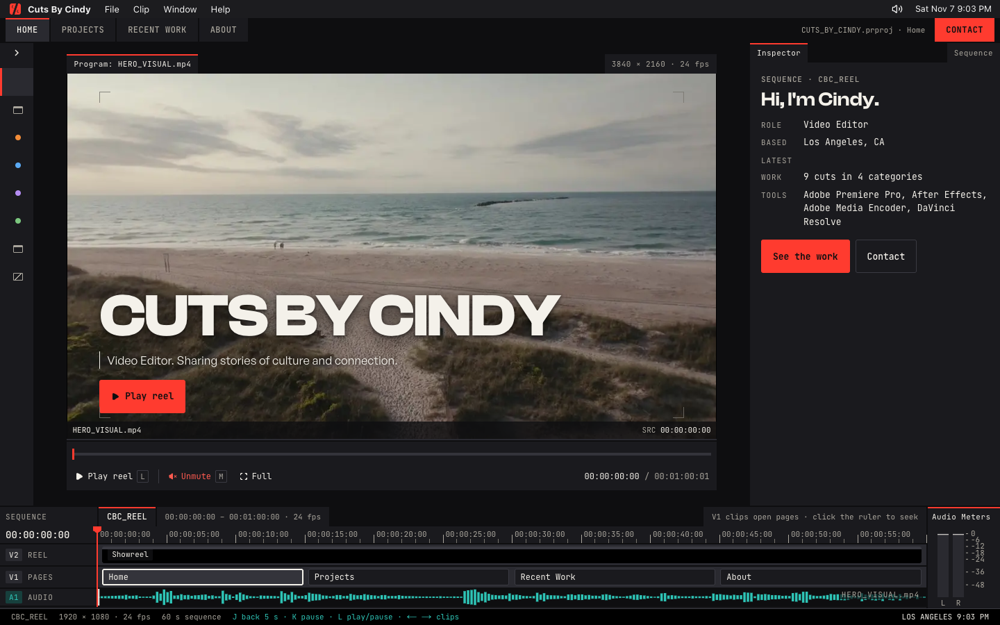

# Cuts By Cindy



The portfolio of Cindy Peralta, a video editor in Los Angeles. The site is built as her edit bay: an app bar, workspace tabs, a project bin, a program monitor, an inspector, a timeline with audio meters, and a razor-cut page change. A small admin panel lets Cindy edit her own content.

## Stack

- Next.js 16 (App Router, Cache Components), React 19, TypeScript, Tailwind v4
- Prisma 7 on Neon Postgres
- Cloudflare Stream (video), Cloudflare R2 (images and files)
- EmailJS (contact form), optional Cloudflare Turnstile
- Vercel hosting, pnpm

## Docs

- [docs/PRODUCT.md](docs/PRODUCT.md): who the site is for and what must stay true
- [docs/DESIGN.md](docs/DESIGN.md): the visual system (tokens, type, components, rules)
- [docs/ARCHITECTURE.md](docs/ARCHITECTURE.md): data model, routes, caching, video pipeline, admin
- [docs/GAMEPLAN.md](docs/GAMEPLAN.md): user stories and the build phases, with progress

## Run it

1. `pnpm install` (this also generates the Prisma client)
2. Copy `.env.example` to `.env` and fill in the keys. Phase 1 needs only the two Neon URLs.
3. `pnpm exec prisma db push` to create the tables, then `pnpm exec prisma db seed` for the starter rows.
4. `pnpm dev`, then open http://localhost:3000

## Admin

- The panel is at `/admin`. It has one password.
- Make the hash with `pnpm exec tsx scripts/hash-password.ts "your password"` and put the output in `.env` as `ADMIN_PASSWORD_HASH`. Set `SESSION_SECRET` to a long random string (`openssl rand -hex 32`).
- To log every session out, change `SESSION_SECRET` and redeploy.
- Uploads (portrait, resume, posters, stills) go from the browser straight to R2. They need `R2_ACCESS_KEY_ID`, `R2_SECRET_ACCESS_KEY`, and `R2_BUCKET` in `.env` (Cloudflare → R2 → Manage API tokens → Object Read & Write, this bucket only), plus this CORS policy on the bucket (R2 → bucket → Settings → CORS policy), with your real domain added to `AllowedOrigins`:

  ```json
  [{ "AllowedOrigins": ["http://localhost:3000"], "AllowedMethods": ["PUT"], "AllowedHeaders": ["content-type"], "MaxAgeSeconds": 3600 }]
  ```

## Scripts

- `pnpm dev`, `pnpm build`, `pnpm start`, `pnpm lint`
- `pnpm exec prisma db seed`: starter rows (real facts only; a public test stream stands in for the reel)
- `pnpm exec tsx scripts/hash-password.ts "..."`: the admin password hash

## Layout

```
app/(site)/      the public pages
app/admin/       the admin panel (login + protected pages)
app/api/         the Stream webhook
components/bay/  the edit-bay frame: app bar, tabs, bin, timeline, keys
components/monitor/  the program monitor and player
components/pages/    page pieces: inspector, rows, credits
components/contact/  the contact dialog
lib/             data reads, actions, Stream and R2 helpers, auth
prisma/          schema and seed
```
